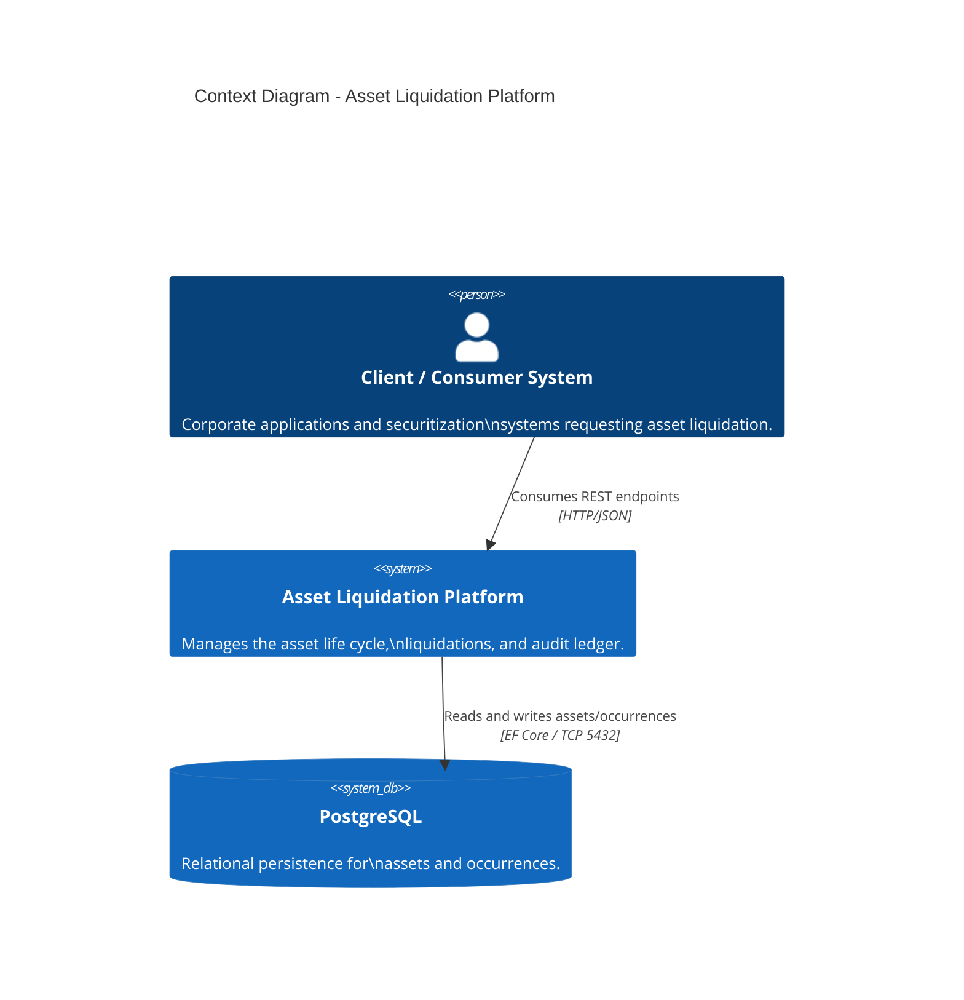
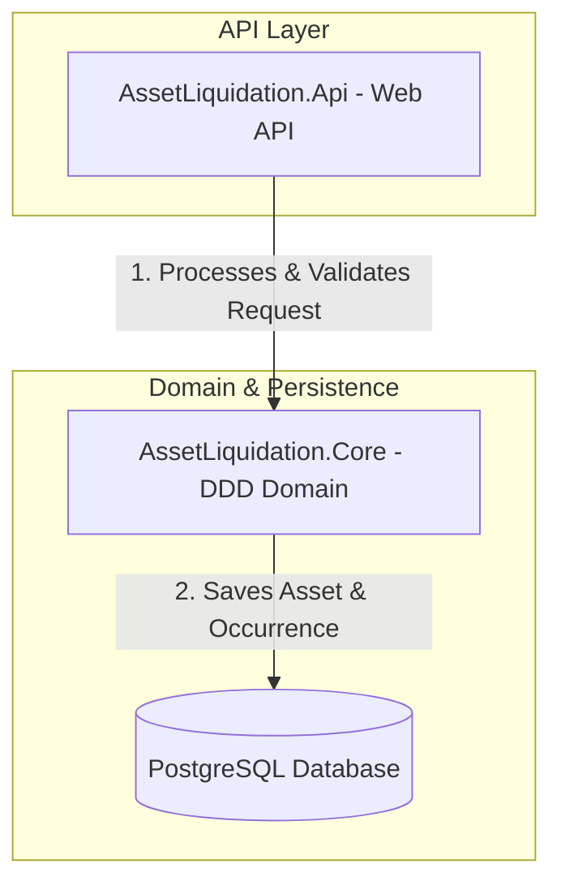
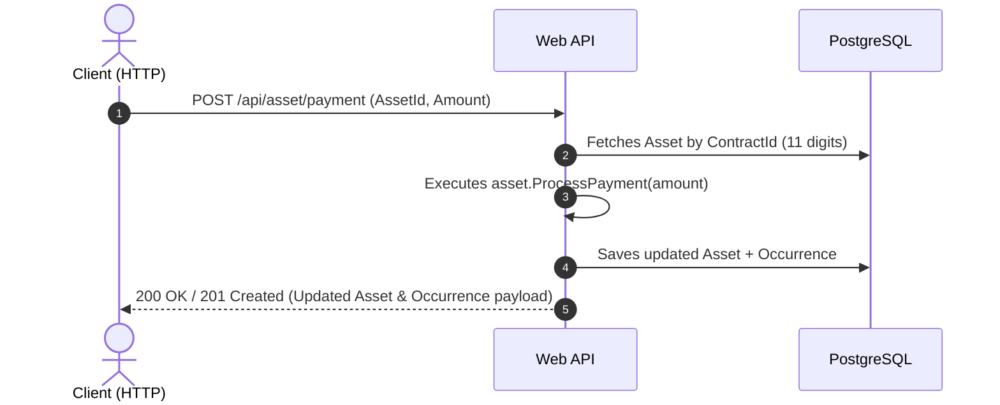

# System Architecture - Asset Liquidation Platform

This document details the software architecture, design patterns, and persistence flow of the asset liquidation platform.

---

## 1. Context Overview (C4 Model - Level 1)

The diagram below illustrates the general system context, the actors interacting with it, and the underlying infrastructure dependencies.

---

## 2. Container Architecture (C4 Model - Level 2)

Details the layer separation, domain boundaries, and data persistence flow.

---

## 3. Sequence Diagram - Synchronous Liquidation Flow

Demonstrates the execution sequence over time when a client triggers a payment or refund event:

---

## 4. Architecture Decision Records (ADRs)

* **DDD (Domain-Driven Design):** Rich domain entities with encapsulation and explicit business rule enforcement (`Asset` and `Occurrence`).
* **Primary Key vs. Business Key:**
  * `Guid` as Primary Key (Surrogate Key) for relational integrity and foreign key indexing.
  * `string` of 11 numeric digits as Business Key for operational contract lookups.
* **Audit Trail:**
  * Synchronous generation of `Occurrence` entities linked via Foreign Key to track all financial operations and lifecycle changes.